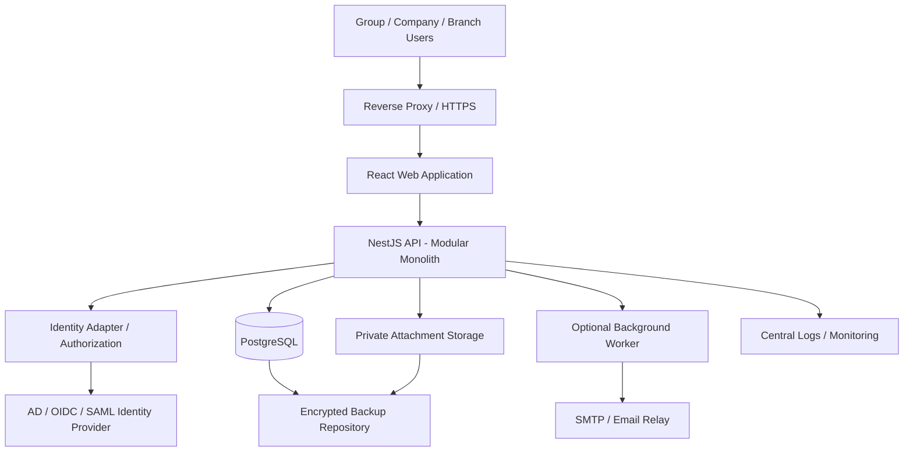

# IT Asset Management System
## Complete Technical Specification
**Version:** 1.0  
**Status:** Proposed for review  
**Target:** Company Group and multi-branch deployment  
**Hosting:** On-premises VMware ESXi  
**Authentication:** Active Directory / SSO plus tightly controlled local break-glass administrator  
**Migration source:** Existing Django IT Asset Management System  
**Proposed stack:** React + TypeScript, NestJS, PostgreSQL, Prisma

---

## 1. Executive Summary

This specification defines a centralized IT Asset Management System (ITAM) for a company group with multiple legal entities, branches, departments, locations, and user access scopes. It replaces the existing Django application in a controlled migration, preserving asset records, assignments, history, attachments, and audit evidence where available.

The target architecture is a **modular monolith** rather than an initial microservices deployment. This reduces operational complexity for an on-premises team while maintaining module boundaries that can evolve later.

### Primary objectives
- Maintain a trusted inventory of IT assets and their lifecycle.
- Track asset ownership, custody, location, assignment, transfer, repair, and retirement.
- Support configurable requests and multi-step approvals.
- Enforce group/company/branch/department data scope on the server.
- Integrate with Active Directory / SSO while preserving a secure emergency access path.
- Provide auditable operations, reports, notifications, and migration reconciliation.
- Run reliably on VMware ESXi with tested backups and disaster recovery procedures.

### Non-goals for initial release
- Full enterprise procurement/ERP replacement.
- Automatic discovery of every endpoint without a separate discovery tool.
- Financial fixed-asset depreciation/accounting as a replacement for the finance system.
- Microservices, Kubernetes, or multi-region active-active architecture.
- Remote command execution or endpoint management functionality.

---

## 2. Scope and Success Criteria

### In scope
1. Organization and branch hierarchy.
2. Users, roles, permissions, and scoped access.
3. Asset catalog and asset register.
4. Asset intake / receiving and purchase references.
5. Asset requests and approvals.
6. Assignment, handover, return, and transfer.
7. Stock, accessories, and spare-device tracking.
8. Maintenance, repair, warranty, and service contracts.
9. Software/license register (initially inventory and expiry tracking).
10. Physical audit and reconciliation.
11. Attachments and document references.
12. Notifications, dashboard, and reporting.
13. Immutable-style audit trail and security event logging.
14. Import/export and legacy Django migration.
15. Backup, restore, monitoring, and operational runbooks.

### Success criteria
- All in-scope legacy assets are either imported, explicitly excluded with a reason, or listed as a migration exception.
- Asset counts and agreed key totals reconcile between old and new systems.
- No user can read or modify records outside their authorized scope through UI, API, exports, or direct object IDs.
- No asset can be actively assigned to two people at once unless the business explicitly supports shared custody.
- Approved state transitions are enforced on the server and recorded in history.
- Break-glass access is tested, monitored, and documented.
- Restore tests demonstrate that database and attachments can be recovered together.
- Pilot users complete agreed UAT scenarios before production cutover.

---

## 3. Proposed Technology Stack

| Layer | Proposed technology | Notes |
|---|---|---|
| Web UI | React + TypeScript | Responsive desktop-first application |
| UI components | Ant Design **or** MUI | Choose one design system and standardize |
| API / backend | NestJS + TypeScript | Modular monolith with validation and authorization |
| API style | REST, versioned `/api/v1` | OpenAPI/Swagger contract |
| ORM | Prisma | Schema and controlled migrations |
| Database | PostgreSQL | ACID transactions, constraints, indexes |
| Authentication | OIDC/SAML SSO where supported; AD/LDAP integration as required | Prefer identity provider / federation over custom password handling |
| Emergency access | Local break-glass account(s) | Disabled or unavailable for ordinary use; monitored and tested |
| Background jobs | Optional Redis-backed worker | Add only for queued notifications, imports, or long jobs |
| File storage | On-premises S3-compatible object storage or secured file service | Store metadata in DB; store files outside public web root |
| Reverse proxy | Nginx or approved equivalent | TLS termination, request limits, security headers |
| Runtime | Supported LTS Node.js version, pinned dependencies | Patch and test upgrades |
| Deployment | VM-based services on VMware ESXi | Separate development, staging, and production |
| Observability | Centralized application/system logs, metrics, alerting | Avoid logging secrets or unnecessary personal data |

### Stack decision
The proposed NestJS + React stack is appropriate if the decision to rewrite is firm and the team can support TypeScript. Do not migrate merely for novelty. First document current Django behavior and prove that the new design covers required business rules.

---

## 4. Architecture

### 4.1 Logical architecture



### 4.2 Deployment principles
- Deploy a small number of well-defined services, not one VM per module.
- Separate production from development and staging.
- Keep PostgreSQL and attachment storage on private network segments.
- Only the reverse proxy should be exposed to the user network; database ports must not be exposed to ordinary clients.
- Use firewall rules to permit only documented service-to-service traffic.
- Use DNS names and a certificate from the organization's trusted PKI or approved certificate authority.
- Do not publish the database, object-storage administration interface, or management ports to the Internet.
- Keep infrastructure administration separate from application administration.
- Size VMs after measuring concurrent users, asset volume, attachment volume, report load, and backup window. Avoid committing to CPU/RAM sizing before discovery and load testing.

### 4.3 Initial environment layout

| Environment | Purpose | Data rule |
|---|---|---|
| Development | Feature development and unit tests | Synthetic or anonymized data only |
| Staging / UAT | Migration rehearsal, integration and acceptance tests | Masked copy only unless approved |
| Production | Live business operations | Controlled access, monitoring, backup, change control |

A separate database per environment is required. Production credentials and secrets must never be copied into development or staging.

### 4.4 Modular monolith boundaries

- `identity`: SSO integration, user provisioning, sessions.
- `authorization`: roles, permissions, scopes, policy enforcement.
- `organizations`: group, company, branch, department, location.
- `people`: employee directory references.
- `assets`: asset register, categories, models, status.
- `receiving`: purchase and receipt references.
- `requests`: request lifecycle.
- `approvals`: configurable approval steps and delegation.
- `assignments`: issue, handover, return, custody.
- `transfers`: branch/company transfer.
- `inventory`: stock, accessories, stock movements.
- `maintenance`: repair, preventive maintenance, vendor records.
- `licenses`: software/license inventory and expiry.
- `audits`: physical checks and discrepancies.
- `documents`: attachment metadata and access checks.
- `notifications`: email and in-app notifications.
- `reports`: scoped queries and exports.
- `audit-log`: security and business audit events.
- `admin`: reference data, settings, import jobs.

Each module owns its business rules. Modules may share a database but should not modify each other's data through uncontrolled direct calls. Use explicit service methods and database transactions.

---

## 5. Organization and Access Model

### 5.1 Organization hierarchy
Recommended logical model:

`Group → Company → Branch → Department / Location`

- A Group can own one or more Companies.
- A Company can have multiple Branches.
- A Branch can contain multiple physical Locations or rooms.
- Departments are associated with a Company and optionally with a Branch, depending on the real organization structure.
- An asset has one accountable Company and a current physical location; its custody can be assigned to an employee or a shared/service custodian.

Avoid duplicating company or branch names into every record as the only relationship. Use foreign keys and stable codes.

### 5.2 Scope model
Roles answer **what actions** a user may perform. Scope answers **which records** the user may act on.

Examples:
- Group IT Administrator: authorized actions across the whole group.
- Company IT Manager: IT actions within assigned company or companies.
- Branch IT Officer: allowed operations within assigned branch(es).
- Department Head: view and approve requests for their department within policy.
- Employee: view own requests and current/past assigned assets.
- Auditor: read-only access to approved scopes and audit reports.
- System Administrator: manages application configuration and technical operation; should not automatically receive unrestricted business-data access unless explicitly approved.

Use explicit user-scope assignments. Do not assume a user's branch from a free-text field.

### 5.3 Authorization requirements
- Deny by default.
- Enforce authorization on every API request and every object lookup.
- Apply scope restrictions to list, detail, create, update, delete, export, attachment download, and report endpoints.
- Never trust `company_id`, `branch_id`, `employee_id`, or role values supplied by the browser without checking them against the authenticated user's allowed scope.
- Require a reason and audit event for privileged scope changes.
- Restrict role administration to specifically authorized administrators.
- Test direct-object-reference attacks by changing IDs in API requests.
- Use soft deletion only where the business requires it; preserve historical records and audit evidence.

---

## 6. Functional Modules and Requirements

### 6.1 Organization Management
- Create and maintain groups, companies, branches, departments, and locations.
- Support active/inactive status and effective dates where necessary.
- Prevent deletion of an organization record referenced by historical transactions; use deactivation or controlled merge.
- Maintain unique codes within the agreed scope.
- Record changes to organizational mappings.

### 6.2 User and Access Management
- Integrate with the selected identity provider.
- Map identity-provider subject/object ID to a stable local user record.
- Support account activation/deactivation, role assignment, scope assignment, and last-login metadata.
- Do not use email address alone as the only permanent identity key because it can change.
- Provide a controlled break-glass procedure described in Section 11.
- Avoid local passwords for ordinary users if SSO is the agreed standard.

### 6.3 Asset Master and Register
Minimum fields:
- Internal database ID (UUID).
- Asset tag (unique, human-readable).
- Category, type, brand, model.
- Serial number and manufacturer identifier where available.
- Company, branch, location.
- Acquisition/received date, purchase reference, cost and currency if recorded.
- Warranty start/end dates.
- Asset status and condition.
- Current custodian/assignment, if any.
- Vendor, support contract, notes.
- Attachment references.
- Created/updated metadata.

Requirements:
- Asset tag must be unique according to a documented global or company-level rule.
- Serial numbers may be blank for some categories; where present, define duplicate detection rules rather than blindly enforcing global uniqueness across all asset types.
- Use controlled vocabularies for status, condition, and category.
- Search by tag, serial, employee, branch, category, status, and model.
- Support barcode/QR label generation as a later enhancement or initial feature if required.
- Record status transitions as events, not only as a mutable current status.

### 6.4 Receiving / Procurement Reference
This module does not replace ERP procurement. It records the evidence needed to connect an asset to its acquisition:
- Purchase order/reference, supplier, received date, invoice reference, cost, currency.
- Receiving inspection and condition.
- Quantity-based receipt for stock items, with individual asset records for serialized devices.
- Partial receipt and discrepancy notes if needed.
- Attachment permissions and retention policy.

### 6.5 Asset Request
- Employees or authorized coordinators submit requests with category/specification, business justification, needed-by date, company/branch/department, and optional project/cost center.
- Requester cannot self-approve unless a documented policy explicitly allows it.
- Duplicate or conflicting requests should be detectable.
- A request has its own status, independent from the asset's status.
- Rejection requires a reason.
- Request cancellation is allowed only in configured states and is audited.

### 6.6 Approval Engine
- Configure approval templates by company, request type, category, value threshold, department, or policy.
- Support sequential approval steps and optional parallel approvals if required.
- Capture approver, decision, timestamp, comment, and delegation information.
- Support delegation with dates, scope, and audit events.
- Rejection, withdrawal, timeout, and escalation rules must be explicit.
- Approval decisions are immutable; corrections use a new event or controlled administrative action, not silent editing.
- Approval engine must validate current state and authority in the backend.
- Never allow a client to set `Approved` directly by submitting a status field.

### 6.7 Assignment, Handover, and Return
- Issue an available asset only after required approvals and checks.
- Capture issuing officer, recipient, date/time, condition, accessories, acknowledgement, and handover document.
- Enforce one active assignment per individually assigned asset unless the category supports shared custody.
- Return process captures condition, accessories, return date, and inspection result.
- After return, asset goes to inspection/available/maintenance based on policy; do not automatically make every returned asset available.
- Maintain assignment history, including past custodians.
- Support employee exit/transfer checklist integration as a later phase.

### 6.8 Asset Transfer
- Support transfer between locations, branches, and companies with explicit source/destination scope.
- Capture request, approval, dispatch, receipt, and discrepancy.
- Update current location only at the defined point in the transfer process.
- Use a database transaction for final custody/location changes.
- Prevent concurrent transfers of the same asset.
- Define whether inter-company transfer changes the accountable company, ownership, cost center, and accounting reference.
- Preserve a complete transfer history.

### 6.9 Inventory and Accessories
- Track stock quantities for non-serialized items such as cables, adapters, and peripherals.
- Track serialized devices individually.
- Record stock movements with type, quantity, source, destination, actor, and reference.
- Prevent negative stock unless a specifically approved business rule allows it.
- Use transactions and concurrency controls for stock issue/receipt.

### 6.10 Maintenance and Repair
- Create work orders linked to an asset.
- Record issue description, diagnosis, vendor, estimate, actual cost, dates, downtime, repair status, and outcome.
- Support scheduled preventive maintenance and reminders.
- Keep service history after the asset is retired.
- Define whether assets under maintenance can be assigned or transferred; default is no.
- Record approval for repair cost thresholds if required.

### 6.11 Warranty, Contracts, Software and Licenses
- Track warranty/contract provider, start/end dates, coverage, reference, and reminders.
- Track software product, entitlement quantity, license type, renewal date, and allocation records.
- Do not store license secrets or activation keys in ordinary text fields. If storage is essential, use a dedicated secrets-management approach and strict access.
- The first release may track compliance and expiry without performing software deployment or endpoint scanning.

### 6.12 Physical Audit
- Create an audit campaign scoped to a company, branch, location, or category.
- Record expected asset, observed status/location/custodian, auditor, date, and discrepancy.
- Support missing, moved, damaged, unregistered, and duplicate-tag exceptions.
- Require review and resolution notes for discrepancies.
- Do not silently overwrite asset records from an audit import.

### 6.13 Attachments and Documents
- Store files outside the publicly served web directory.
- Store metadata and storage key in the database.
- Validate allowed file types and size; use malware scanning where available.
- Authorize downloads through the API; never expose predictable public file URLs.
- Use randomized object keys and safe content-disposition headers.
- Back up file content and metadata together.
- Record who uploaded or downloaded sensitive documents when appropriate.

### 6.14 Reports and Dashboard
Initial reports:
- Total assets by group/company/branch/category/status.
- Available, assigned, in-maintenance, missing, retired assets.
- Assignment and transfer history.
- Warranty and contract expiry.
- Maintenance costs and downtime.
- Stock balances and movement.
- Asset acquisition cost where data quality permits.
- Physical audit discrepancies.
- Requests waiting for each approver.
- Migration exceptions and data-quality dashboard.

All reports and exports must enforce the same scope rules as interactive pages. Large exports should be queued, time-limited, audited, and access-controlled.

---

## 7. Asset and Request State Models

### 7.1 Suggested asset lifecycle states
The final values must be agreed with business owners. Suggested states:

- `DRAFT` (optional, for unapproved imported/created records)
- `IN_STOCK`
- `AVAILABLE`
- `RESERVED`
- `ASSIGNED`
- `IN_TRANSIT`
- `UNDER_INSPECTION`
- `IN_MAINTENANCE`
- `MISSING`
- `RETIRED`
- `DISPOSED`

Do not mix `REQUESTED` or `APPROVED` into asset status; those belong to the request/approval workflow.

### 7.2 Suggested request states
- `DRAFT`
- `SUBMITTED`
- `IN_REVIEW`
- `PENDING_APPROVAL`
- `APPROVED`
- `REJECTED`
- `CANCELLED`
- `FULFILLED`
- `CLOSED`

### 7.3 Transition rules
- State transitions are explicit server-side commands, not arbitrary status updates.
- Validate actor permission, record scope, current state, prerequisites, and concurrency version.
- Store each transition in a history/event table with actor, timestamp, reason, and correlation ID.
- Use optimistic concurrency (e.g., version field) or row locking for critical operations.
- Invalid transitions return a consistent conflict response such as HTTP 409.

---

## 8. Core Workflows

### 8.1 Request to issue
1. Employee submits request.
2. System validates user, organization scope, required fields, and duplicate/open requests.
3. Department head reviews business need and budget/cost-center policy.
4. IT checks stock, specification, reuse options, and compatibility.
5. Approval engine routes to required approvers based on policy.
6. If no stock is available, route to procurement/receiving reference process.
7. Authorized asset officer reserves an available asset.
8. Asset is issued and handover evidence recorded.
9. Employee acknowledges receipt.
10. Request is marked fulfilled/closed; audit events and notifications are created.

### 8.2 Return
1. Employee/manager or IT initiates return.
2. IT receives the asset and accessories.
3. Inspection records condition and missing items.
4. Asset is routed to `AVAILABLE`, `UNDER_INSPECTION`, or `IN_MAINTENANCE`.
5. Assignment is closed with return time; history is retained.
6. Any damage or cost recovery process follows company policy.

### 8.3 Branch transfer
1. Source branch submits transfer request with destination and reason.
2. Source authority approves.
3. Destination authority confirms expected receipt when policy requires.
4. Asset enters `IN_TRANSIT`; dispatch evidence is recorded.
5. Destination records receipt and condition.
6. In one transaction, current location/custody is updated and transfer completed.
7. Discrepancies create an exception for review; do not silently complete.
8. Notifications and audit events are generated.

### 8.4 Repair
1. IT opens a maintenance work order.
2. Asset becomes unavailable for assignment as policy requires.
3. Approval is requested if estimated cost exceeds configured threshold.
4. Vendor/technician diagnosis, quote, repair, and costs are recorded.
5. IT performs return-to-service inspection.
6. Asset is made available or marked retired/missing according to decision.
7. Warranty claim and expense reports are updated.

### 8.5 Retirement/disposal
1. Authorized user proposes retirement with reason and supporting evidence.
2. Approval follows asset category/value/company policy.
3. Outstanding assignment, transfer, or maintenance work must be resolved.
4. Asset is marked `RETIRED` or `DISPOSED`; record is not physically deleted.
5. Disposal certificate or approval attachment is stored.
6. Reports exclude retired assets from available stock but preserve history.

---

## 9. Database Design

Use PostgreSQL with UUID primary keys, foreign keys, appropriate unique constraints, check constraints, and indexes. The schema below is a logical baseline; detailed Prisma schema should follow validated requirements and legacy data mapping.

### 9.1 Core tables

#### `groups`
- `id UUID PK`
- `code VARCHAR UNIQUE NOT NULL`
- `name VARCHAR NOT NULL`
- `status`
- `created_at`, `updated_at`

#### `companies`
- `id UUID PK`
- `group_id UUID FK groups`
- `code VARCHAR NOT NULL`
- `name VARCHAR NOT NULL`
- `status`
- unique (`group_id`, `code`)

#### `branches`
- `id UUID PK`
- `company_id UUID FK companies`
- `code`, `name`, `status`
- unique (`company_id`, `code`)

#### `departments`
- `id UUID PK`
- `company_id UUID FK companies`
- optional `branch_id UUID FK branches`
- `code`, `name`, `status`
- uniqueness rule to be finalized for company/branch structure

#### `locations`
- `id UUID PK`
- `company_id UUID FK companies`
- `branch_id UUID FK branches`
- `code`, `name`, `location_type`, `status`

#### `users`
- `id UUID PK`
- `identity_provider`, `identity_subject` (unique pair)
- `employee_code` (nullable until validated)
- `display_name`, `email`, `status`
- optional `department_id`
- `created_at`, `updated_at`, `last_login_at`

#### `roles`, `permissions`, `role_permissions`
- Stable role and permission definitions.
- Permission examples: `asset.read`, `asset.create`, `asset.update`, `asset.assign`, `asset.transfer`, `asset.retire`, `request.approve`, `audit.read`, `access.manage`.

#### `user_roles`
- `user_id`, `role_id`
- optional assignment metadata and effective dates

#### `user_access_scopes`
- `id UUID PK`
- `user_id UUID FK users`
- scope type and relevant group/company/branch/department ID
- `valid_from`, `valid_to`, `created_by`
- Validate scope references in application or use normalized scope tables / separate typed scope tables to avoid ambiguous polymorphic foreign keys.

#### `asset_categories`
- `id UUID PK`
- `code`, `name`, `serialized_tracking`, `requires_assignment`, `status`

#### `asset_models`
- `id UUID PK`
- `category_id`, `brand`, `model_name`, optional model reference

#### `assets`
- `id UUID PK`
- `asset_tag VARCHAR UNIQUE NOT NULL`
- `category_id UUID FK`
- optional `model_id UUID FK`
- `serial_number`, `manufacturer_asset_id`
- `company_id UUID FK`
- `branch_id UUID FK`
- optional `location_id UUID FK`
- `status`, `condition`
- `received_at`, `purchase_reference`, `purchase_cost NUMERIC`, `currency CHAR(3)`
- `warranty_start`, `warranty_end`
- optional `current_custodian_user_id UUID FK users`
- `version INT NOT NULL DEFAULT 1`
- `legacy_source`, `legacy_id`
- `created_at`, `updated_at`, `created_by`, `updated_by`
- indexes on company/branch/status/category/serial/tag/custodian
- unique (`legacy_source`, `legacy_id`) when legacy identifiers exist

#### `asset_assignments`
- `id UUID PK`
- `asset_id UUID FK assets`
- `employee_user_id UUID FK users`
- `issued_at`, `returned_at`
- `issued_by`, `received_by`
- `condition_out`, `condition_in`
- `handover_reference`, `notes`
- enforce at most one active assignment per asset using a partial unique index where `returned_at IS NULL`, unless shared custody is supported

#### `asset_requests`
- `id UUID PK`
- `request_number` unique
- `requester_user_id`
- `company_id`, `branch_id`, `department_id`
- `category_id`, requested specification, justification, needed_by
- `status`, `submitted_at`, `closed_at`
- `legacy_source`, `legacy_id`

#### `approval_steps`
- `id UUID PK`
- `request_id UUID FK`
- `step_order`, `approver_user_id`
- `status`, `decision`, `comment`, `decided_at`
- optional `delegated_from_user_id`
- prevent duplicate active decisions for the same step

#### `asset_transfers`
- `id UUID PK`
- `transfer_number` unique
- `asset_id`
- `from_company_id`, `from_branch_id`, `from_location_id`
- `to_company_id`, `to_branch_id`, `to_location_id`
- `requested_by`, `approved_by`, `dispatched_at`, `received_at`
- `status`, `reason`, `receipt_condition`

#### `maintenance_records`
- `id UUID PK`
- `work_order_number` unique
- `asset_id`
- `reported_at`, `reported_by`, `problem_description`
- `vendor_id` optional
- `estimated_cost`, `actual_cost`, `currency`
- `status`, `started_at`, `completed_at`, `outcome`

#### `vendors`
- `id UUID PK`
- `code`, `name`, contact fields as approved, `status`

#### `stock_items`, `stock_movements`
- Stock item master for non-serialized inventory.
- Movements capture item, location, movement type, quantity, source/destination, actor, timestamp, and reference.
- Prevent negative balances using transaction-safe validation and/or ledger-derived balance controls.

#### `software_products`, `licenses`, `license_allocations`
- Product and entitlement records, quantity, term, renewal date, assigned user/device, allocation/revocation dates.
- Store secrets separately if truly required.

#### `audit_campaigns`, `audit_results`
- Campaign scope, auditor, dates, expected asset, observed values, discrepancy, resolution.

#### `attachments`
- `id UUID PK`
- `storage_key`, `original_filename`, `content_type`, `size_bytes`, checksum
- owning entity reference, uploader, upload timestamp, classification
- ensure entity-level authorization on every download

#### `asset_events`
- `id UUID PK`
- `asset_id`, event type, actor, timestamp, reason, JSONB event details, correlation ID
- append-only through application policy

#### `audit_logs`
- `id UUID PK`
- actor, action, entity type/ID, timestamp, request/correlation ID, outcome, safe metadata
- do not log passwords, tokens, session cookies, private keys, or unnecessary sensitive data

#### `notifications`, `import_jobs`, `migration_exceptions`
- Delivery status and retry information.
- Import job status, source, started/finished times, counts.
- Exceptions with legacy key, reason, owner, resolution status, and resolution notes.

### 9.2 Database rules
- Use `NUMERIC` for monetary values, not floating-point.
- Store timestamps consistently in UTC; display in the configured local timezone.
- Use database foreign keys and transactions.
- Use soft deletion/deactivation for master data referenced by historical records.
- Avoid unrestricted JSON blobs as a substitute for relational structure; JSONB is appropriate for event details and flexible metadata with defined governance.
- Add indexes based on real query plans and workload.
- Define data retention and privacy requirements before launch.
- Use migrations in source control; never edit production schema manually without a controlled change record.

---

## 10. API Specification

All APIs are versioned under `/api/v1`. Use JSON, documented OpenAPI schemas, consistent error responses, pagination, and server-side authorization.

### 10.1 General conventions
- Authentication: SSO session or validated bearer token according to the selected identity provider.
- `Content-Type: application/json` for JSON endpoints.
- Use opaque UUIDs for internal record identifiers.
- List endpoints support `page`, `pageSize`, sort allowlists, and filter allowlists.
- Avoid unrestricted client-supplied field names for sorting or filtering.
- Use an `Idempotency-Key` for supported retry-sensitive create operations.
- Use a version field or `If-Match`/ETag for concurrent updates.
- Use `400` for malformed input, `401` for unauthenticated, `403` for forbidden, `404` for inaccessible/nonexistent records where policy avoids information leakage, `409` for state conflicts, `422` for semantic validation, and `500` for unexpected server errors.
- Include a correlation ID in responses and logs.
- Never expose stack traces or database details to clients.

### 10.2 Identity and session
- `GET /api/v1/me` — current user, roles, and permitted scopes.
- `POST /api/v1/auth/logout` — terminate local application session if applicable.
- SSO login/callback endpoints depend on the chosen OIDC/SAML integration.
- `POST /api/v1/admin/users/{id}/scopes` — authorized administrators only; audit every change.
- Do not expose a public endpoint to mint arbitrary user tokens.

### 10.3 Organization APIs
- `GET /api/v1/groups`
- `GET /api/v1/companies`
- `GET /api/v1/branches`
- `GET /api/v1/departments`
- `GET /api/v1/locations`
- `POST/PATCH` endpoints only for authorized organization administrators.
- All list/detail responses are filtered by the caller's scope.

### 10.4 Asset APIs
- `GET /api/v1/assets`
- `POST /api/v1/assets`
- `GET /api/v1/assets/{id}`
- `PATCH /api/v1/assets/{id}`
- `GET /api/v1/assets/{id}/events`
- `POST /api/v1/assets/{id}/retirement-requests`
- `POST /api/v1/assets/{id}/attachments`
- `GET /api/v1/assets/{id}/attachments/{attachmentId}`

Do not provide a generic endpoint that lets the client change protected fields such as status, current custodian, or branch without using the appropriate lifecycle command.

### 10.5 Request and approval APIs
- `GET /api/v1/requests`
- `POST /api/v1/requests`
- `GET /api/v1/requests/{id}`
- `POST /api/v1/requests/{id}/submit`
- `POST /api/v1/requests/{id}/cancel`
- `POST /api/v1/requests/{id}/approve`
- `POST /api/v1/requests/{id}/reject`
- `POST /api/v1/requests/{id}/fulfill`
- `GET /api/v1/approvals/inbox`

Approval body includes a decision and optional comment; the backend determines the authenticated approver and validates that they are authorized for the current step. Do not accept `approverId` as trusted input.

### 10.6 Assignment and transfer APIs
- `POST /api/v1/assets/{id}/assign`
- `POST /api/v1/assignments/{id}/return`
- `POST /api/v1/transfers`
- `GET /api/v1/transfers/{id}`
- `POST /api/v1/transfers/{id}/approve`
- `POST /api/v1/transfers/{id}/dispatch`
- `POST /api/v1/transfers/{id}/receive`

All commands must validate current state, actor scope, prerequisites, and concurrency. Use a database transaction for changes that must succeed or fail together.

### 10.7 Maintenance and audit APIs
- `POST /api/v1/assets/{id}/maintenance`
- `PATCH /api/v1/maintenance/{id}`
- `POST /api/v1/maintenance/{id}/complete`
- `POST /api/v1/audit-campaigns`
- `POST /api/v1/audit-campaigns/{id}/results`
- `POST /api/v1/audit-results/{id}/resolve`

### 10.8 Reporting and migration APIs
- `GET /api/v1/reports/assets-summary`
- `GET /api/v1/reports/warranty-expiry`
- `GET /api/v1/reports/maintenance`
- `POST /api/v1/exports` — create an authorized export job.
- `GET /api/v1/exports/{id}` — job status and secured download.
- Import endpoints must be restricted to migration/admin roles and should not be enabled for ordinary users in production.
- Prefer a controlled command-line migration job for the initial Django migration over a public web endpoint.

### 10.9 Example error response
```json
{
  "statusCode": 409,
  "code": "ASSET_STATE_CONFLICT",
  "message": "The asset cannot be assigned in its current state.",
  "correlationId": "server-generated-correlation-id"
}
```

---

## 11. Authentication, SSO, and Break-Glass Access

### 11.1 Preferred SSO design
- Prefer OIDC or SAML federation through an approved identity provider integrated with Active Directory.
- If direct LDAP authentication is required, use LDAPS with certificate validation and a least-privileged service account; never send credentials over plain LDAP.
- Map the stable directory object identifier or identity-provider subject to the local user ID.
- Define behavior for disabled directory accounts, renamed users, leavers, group membership changes, and identity-provider outage.
- Do not grant business roles merely because a user can authenticate successfully.
- Map directory groups to application roles only through an approved, documented mapping.
- Test logout/session expiry and revocation behavior.

### 11.2 Break-glass account controls
Break-glass access is for a documented emergency such as an identity-provider outage or a recovery incident. It is not an everyday alternative login.

Required controls:
1. Keep the number of break-glass accounts minimal (prefer two independently controlled accounts if operationally justified).
2. Use unique, high-entropy credentials stored in an approved enterprise password vault or sealed emergency procedure.
3. Require MFA where technically possible without creating a single point of failure; document a secure fallback if the identity provider is unavailable.
4. Restrict network access to the management network or approved administrator workstations where feasible.
5. Alert on every successful and failed break-glass login.
6. Record reason, incident/ticket, user, start/end time, and actions taken.
7. Review logs promptly after use and rotate credentials after an incident or suspected exposure.
8. Test the emergency path periodically without weakening normal SSO.
9. Do not hard-code a default password or store secrets in source control, environment files committed to Git, or database seed data.
10. Keep break-glass recovery instructions accessible during an identity-provider outage.

### 11.3 Security baseline
- HTTPS everywhere; modern TLS configuration.
- Secure, HttpOnly, SameSite cookies when cookie-based sessions are used.
- CSRF protection for cookie-authenticated state-changing requests.
- Rate limiting and lockout/alert policy appropriate to SSO and local emergency login.
- Input validation and output encoding.
- Parameterized database access through the ORM and reviewed raw SQL where needed.
- CORS allowlist; do not use wildcard origins with credentials.
- Content Security Policy and other appropriate security headers.
- File upload restrictions, malware scanning where available, and private download authorization.
- Secret management, dependency scanning, patching, and protected CI/CD secrets.
- Least-privilege service accounts and separate administrator accounts.
- Regular vulnerability scanning and periodic penetration testing.
- Security event monitoring and incident-response procedures.
- Review OWASP ASVS and OWASP API Security guidance during security testing.

---

## 12. VMware ESXi On-Premises Deployment

### 12.1 Suggested service placement
A small deployment can begin with a few VMs, subject to sizing and performance tests:

- **Application VM:** reverse proxy and/or React static web files, NestJS API, optional worker.
- **Database VM:** PostgreSQL on a private network.
- **Storage/backup service:** secured attachment storage and backup target, preferably with a separate failure domain.
- **Monitoring/logging:** existing organization platform or a separate service if available.

Do not treat a VM snapshot as the only database backup. Use PostgreSQL-aware backups and application-consistent file backups.

### 12.2 Network and firewall
- Place application, database, management, and backup services in appropriate network segments/VLANs.
- Permit user HTTPS traffic only to the approved application endpoint.
- Permit database connections only from approved application/administration hosts.
- Permit outbound SMTP/relay and identity-provider traffic only as required.
- Restrict SSH/RDP/administrative interfaces to the management network.
- Use internal DNS and trusted TLS certificates.
- Document every required port and source/destination pair before firewall changes.

### 12.3 Backup and recovery
Define formal Recovery Point Objective (RPO) and Recovery Time Objective (RTO) with management. Example targets must be approved rather than assumed.

- Back up PostgreSQL using a suitable database-aware method.
- Back up attachment storage and configuration/secrets according to policy.
- Encrypt backups in transit and at rest.
- Keep at least one protected/offline or separately administered copy where feasible.
- Monitor backup completion and failure.
- Perform scheduled restore tests in an isolated environment.
- Verify application records and attachments after restore.
- Document recovery steps, credentials access, dependencies, and decision authority.

### 12.4 High availability
For initial release, a well-backed-up single application deployment may be acceptable if the business approves the risk. PostgreSQL HA, redundant application instances, and storage replication should be based on agreed RTO/RPO and budget. A single ESXi host remains a hardware failure domain even if multiple VMs exist.

---

## 13. Django Data Migration Plan

### 13.1 Migration principles
- Treat the old Django application and database as the authoritative source until cutover.
- Never use production data in development without authorization and masking.
- Preserve original IDs in migration mapping fields.
- Keep a read-only, recoverable copy of the old system after cutover according to retention policy.
- Avoid dual-writing the same transactions to both systems unless a carefully tested synchronization design is required.
- Use repeatable, idempotent migration scripts with a dry-run mode and clear logs.

### 13.2 Phase A — Discovery
Inventory:
- Django version, Python version, installed apps, models, custom workflows, scheduled tasks.
- Database engine/version, tables, constraints, indexes, triggers, encoding, timezone.
- Users, roles, groups, branch/company mapping, and any implicit permission logic.
- Uploaded files, stored paths, media configuration, and references.
- Reports, exports, integrations, email tasks, QR/barcode generation, and audit behavior.
- Current asset and assignment counts, duplicate tags/serials, orphaned foreign keys, blank values, and inconsistent statuses.

Deliverable: signed-off source-to-target mapping workbook/document and exception list.

### 13.3 Phase B — Mapping and transformation
Create a mapping table for each source entity:

| Legacy source | Target entity | Transformation | Validation |
|---|---|---|---|
| Django asset model | `assets` | Map category/status/company/branch; normalize dates | Count, required fields, unique tag |
| Django employee/user | `users` | Map to stable directory identity where confirmed | Duplicate identity, inactive user |
| Assignment table | `asset_assignments` | Preserve issue/return dates and custodian history | No overlapping active assignments |
| Transfer/history table | `asset_transfers` / `asset_events` | Convert legacy event types | Timeline and count reconciliation |
| Django media files | `attachments` | Copy to private storage; map old paths to new keys | File count, checksum, access test |
| Approval records | `asset_requests` / `approval_steps` | Preserve decisions, actors, dates, reasons | Approval history and orphan checks |

The actual mapping depends on the existing Django schema; do not assume these source table names match the live system.

### 13.4 Phase C — Data quality and rehearsal
1. Take a consistent backup of the source database and attachments.
2. Run profiling and produce data-quality reports.
3. Agree remediation for duplicates, invalid relationships, and unknown statuses.
4. Build import scripts with explicit transformation rules.
5. Run a dry-run and import into staging.
6. Compare row counts, totals, sample records, assignment histories, attachments, and reports.
7. Re-run import to verify idempotency.
8. Perform negative tests for bad references and invalid data.
9. Obtain business-owner sign-off on migration exceptions.

### 13.5 Phase D — Pilot
- Select one company or branch with representative asset types and workflows.
- Import a controlled dataset or a verified staging copy.
- Test SSO, role/scope restrictions, request/approval, issue/return, transfer, maintenance, reporting, and file access.
- Collect issues and fix critical defects before expansion.
- Keep the old system authoritative during the pilot unless a formally approved cutover plan says otherwise.

### 13.6 Phase E — Production cutover
1. Approve the change window and communicate downtime/read-only period.
2. Confirm recent source backup and a tested restore path.
3. Put the Django system into read-only mode or stop writes.
4. Record the source database cutoff timestamp and final counts.
5. Run final delta/full migration according to the tested approach.
6. Run reconciliation checks and resolve blocking discrepancies.
7. Validate SSO, break-glass access, email, attachments, reports, and scoped access.
8. Obtain business and IT go/no-go approval.
9. Direct users to the new system.
10. Monitor errors, queues, access logs, and user feedback closely.
11. Keep the old system read-only and preserve it for rollback/evidence.

### 13.7 Rollback
Rollback must be designed before cutover. Define:
- Go/no-go thresholds and who decides.
- Maximum acceptable outage.
- How the old Django system is restored as authoritative.
- How transactions entered into the new system during the rollback window are identified and reconciled.
- DNS/reverse-proxy changes needed to direct users back.
- Data backup and audit evidence retention.
- User communication and incident logging.

Do not simply point users back to Django after new-system transactions have occurred without reconciling those transactions. Avoid simultaneous writes to both systems.

### 13.8 Reconciliation checklist
- Source and target row counts by entity and company/branch.
- Unique asset tag validation.
- Serial number and duplicate review.
- Assets grouped by category/status.
- Current custodian and active assignment checks.
- Historical assignment and transfer counts.
- Request/approval decision history.
- Monetary totals where source data is reliable.
- Attachment count and checksums.
- Orphaned records and migration exceptions.
- Reports compared between systems.
- Sample record review by IT and business owners.

---

## 14. Testing Strategy

### 14.1 Test levels
- **Unit tests:** business rules, transition rules, approval routing, scope logic.
- **Integration tests:** PostgreSQL transactions, identity provider, email relay, file storage.
- **API tests:** authentication, validation, status codes, pagination, filtering, object-level authorization.
- **UI tests:** core journeys, error states, accessibility, responsive layout.
- **End-to-end tests:** request → approval → issue; return; transfer; repair; retirement.
- **Security tests:** role bypass, cross-company/branch access, IDOR, CSRF, XSS, injection, upload abuse, session handling, brute-force controls, audit tampering.
- **Migration tests:** counts, data mapping, attachments, idempotency, failed-row handling, reruns.
- **Performance tests:** expected peak concurrent users, large asset lists, exports, and reports.
- **Backup/restore tests:** database and files restored to a usable application state.
- **UAT:** authorized representatives from IT, branches, department heads, management, and audit/finance where relevant.

### 14.2 Critical acceptance tests
1. Branch user cannot view another branch's asset by changing its UUID.
2. Company manager cannot approve a request outside their authorized company.
3. Employee cannot approve their own request where policy prohibits it.
4. An asset cannot be issued while in maintenance, in transit, retired, or already actively assigned.
5. Two concurrent assignment requests cannot create two active assignments for one asset.
6. Transfer does not update location before the defined receipt/commit point.
7. Rejected approval requires a reason and preserves the decision.
8. Returned asset is inspected before becoming available.
9. Unauthorized user cannot download an attachment by guessing its ID.
10. Every privileged scope change and break-glass login generates an audit/security event.
11. Import rerun does not duplicate records.
12. Restore recovers database records and associated files.
13. Exported reports enforce the same scope as the UI.
14. Disabled AD/SSO users cannot continue using a session beyond the documented revocation window.
15. Break-glass access works during the documented SSO outage scenario and is auditable.

### 14.3 Release gates
- No open critical/high security defects without formally approved risk acceptance.
- No unresolved critical data reconciliation discrepancies.
- Backup and restore test passed.
- SSO and break-glass paths verified.
- UAT sign-off received.
- Monitoring, support owner, rollback plan, and user communications ready.

---

## 15. Non-Functional Requirements

| Area | Requirement |
|---|---|
| Availability | Set target based on business needs and infrastructure budget |
| Performance | Agree response-time targets and test with representative data |
| Scalability | Support more companies/branches without schema redesign |
| Security | Least privilege, server-side scope enforcement, audit, secure file handling |
| Reliability | Transactional state changes, safe retries, observable background jobs |
| Maintainability | Module boundaries, automated tests, code review, dependency updates |
| Usability | Search/filter, clear statuses, validation messages, keyboard-accessible UI |
| Localization | Decide supported UI languages and date/time/currency display rules |
| Accessibility | Aim for WCAG 2.2 AA for primary workflows where feasible |
| Data integrity | Foreign keys, unique constraints, state-transition validation, reconciliation |
| Recovery | Approved RPO/RTO, documented and tested restores |
| Auditability | Traceable privileged actions and lifecycle changes |
| Compatibility | Supported browsers and documented client requirements |

---

## 16. DevOps, Release, and Support

### Source control
- Keep frontend, backend, database schema, deployment configuration, and migration scripts in version control.
- Protect main/release branches.
- Require pull-request review and automated tests.
- Never commit secrets, real exports, or production attachments.

### CI/CD
- Lint and type-check.
- Run unit/integration tests.
- Scan dependencies and container images if containers are used.
- Build immutable release artifacts.
- Deploy to staging first; promote the same tested artifact to production.
- Require approval for production deployment and database migrations.
- Maintain a release log and rollback instructions.

### Operations
- Assign a technical owner and business owner for each module.
- Monitor application health, disk capacity, database growth, backup jobs, and failed notifications.
- Establish incident severity and escalation procedures.
- Patch operating systems, runtime, dependencies, and database on a defined schedule.
- Review privileged access periodically.
- Maintain runbooks for SSO outage, database restore, attachment restore, failed migration, and emergency access.

---

## 17. Delivery Plan and Indicative Timeline

These are planning estimates, not a commitment. Actual duration depends on team size, existing data quality, integration complexity, and review cycles.

| Phase | Estimate | Exit criteria |
|---|---:|---|
| Discovery and requirements | 1–2 weeks | Current behavior, scope, data mapping, and acceptance criteria approved |
| Architecture and UX prototype | 2–3 weeks | Architecture decisions and primary screens accepted |
| Core platform and master data | 3–5 weeks | Organization, identity, scope, and asset register tested |
| Lifecycle and workflows | 3–5 weeks | Request, approval, issue, return, transfer, maintenance tested |
| Migration rehearsal and integrations | 2–4 weeks | Reconciliation and SSO/email tests pass |
| UAT, security, pilot | 2–3 weeks | Sign-off and critical defects closed |
| Cutover and stabilization | 1–2 weeks | Production stable; support ownership transferred |

Some work can run in parallel. A practical initial planning window is approximately **13–24 weeks**, to be refined after discovery.

### Suggested team
- Product/business owner: defines policy and accepts workflows.
- Technical lead/architect: owns design and delivery.
- Backend developer(s): NestJS, data model, API, migration.
- Frontend developer: React UI and accessibility.
- QA/test engineer: automation, UAT coordination, regression.
- Infrastructure/security administrator: VMware, network, TLS, backups, monitoring, identity.
- IT asset process owners from pilot branches.

A smaller team can combine roles, but QA, security review, and business sign-off should not be omitted.

---

## 18. Decisions Required Before Development

Confirm the following during discovery:

1. Exact Group → Company → Branch → Department structure.
2. Asset-tag numbering policy: globally unique or unique per company.
3. Whether inter-company transfers change ownership and accounting responsibility.
4. Approval thresholds and who approves each request/transfer/repair/retirement.
5. Whether employees can request assets directly or only through department coordinators.
6. AD integration method: OIDC/SAML identity provider, or LDAPS if federation is unavailable.
7. Expected number of assets, users, concurrent users, attachments, and annual growth.
8. Current Django database engine and version, model schema, media storage, and custom behavior.
9. Required reports, export formats, and retention rules.
10. Approved RPO/RTO and acceptable downtime.
11. Whether software licenses and non-serialized stock are required in release one.
12. UI language(s), timezone, and currency rules.
13. Hosting VM/network design, certificate source, SMTP relay, and backup target.
14. Who can access break-glass credentials and how emergency use is reviewed.
15. Pilot branch, UAT owners, cutover window, and rollback decision authority.

---

## 19. Recommended Implementation Order

1. **Discovery pack:** document current Django behavior, data schema, and all existing features.
2. **Policy pack:** organization hierarchy, role/scope matrix, approval rules, asset lifecycle.
3. **Architecture pack:** deployment, identity integration, database schema, API contracts.
4. **Prototype:** dashboard, asset list/detail, request, approval inbox.
5. **Foundation:** organization, identity, authorization, audit logging, asset master.
6. **Lifecycle:** assignment, return, transfer, maintenance, retirement.
7. **Migration tooling:** repeatable import, attachment transfer, reconciliation reports.
8. **Pilot/UAT:** test with representative branches and roles.
9. **Production cutover:** final migration, go/no-go, monitoring, rollback readiness.
10. **Post-launch:** fix prioritized issues, add license tracking, barcode/QR, discovery integrations, and advanced reporting as approved.

---

## 20. Final Recommendation

Build the replacement as a **React + TypeScript frontend, NestJS modular monolith, PostgreSQL database, and Prisma-managed schema**, deployed on VMware ESXi with separate staging and production environments. Use AD-backed SSO for normal access and a tightly controlled, monitored local break-glass path for emergencies.

The highest-risk areas are not the UI itself. They are:
- correct company/branch authorization,
- preserving legacy asset and assignment history,
- enforcing lifecycle and approval transitions,
- safe identity-provider outage handling,
- protecting attachments and audit records,
- and ensuring migration reconciliation and rollback are proven before cutover.

Do not begin with a full production rewrite based only on this document. First perform a structured review of the existing Django source/database and validate this specification with IT, management, and representative branch users. Then finalize the detailed schema, API contracts, access matrix, migration mappings, and acceptance tests.

**Specification status:** Proposed baseline for stakeholder review. All business policies, sizing, RPO/RTO, approval rules, and source-to-target mappings must be confirmed before production implementation.
